# PeanutButterJelly (PB&J)

**Mining Hidden Gems Around You.** PB&J helps people in Mumbai find small, good things to do: workshops, gigs, pop-ups, supper clubs and last-minute plans with new people. Hosts list their events, members find them, and everyone stays in touch through the event's own group chat.

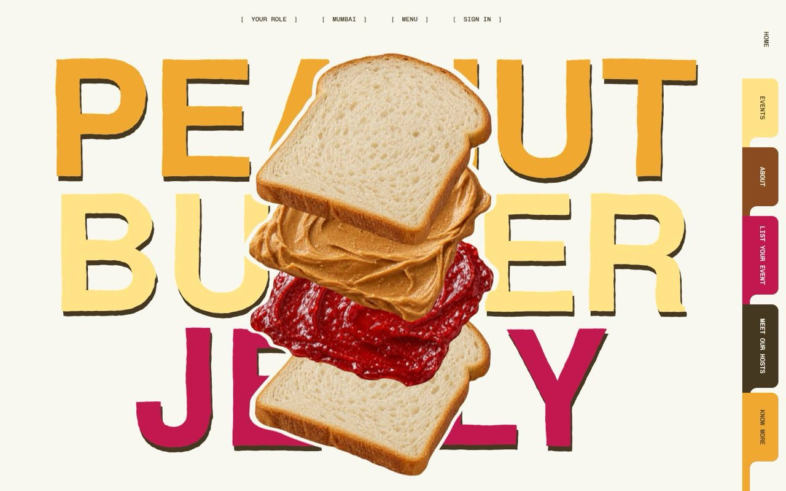

## The three parts

| Part | Where | Who it's for | What it does |
|---|---|---|---|
| **The website** | `/` | Anyone | Six folder tabs: **Home**, **Events**, **About**, **List Your Event**, **Meet Our Hosts** and **Know More**. Tells people what PB&J is, shows events and collects sign-ups from guests, hosts and brands. |
| **The Spontys app** | `/spontys.html` | Members and Sponty planners | A phone-first app: **For you** (posts, highlights, lists), **Ask FUN** (search in plain words), **Messages** (each event's group chat) and a **Profile** with saved, attended and hosted events. |
| **The host dashboard** | `/dashboard.html` | People who run events | Sign in, create an event in 8 steps, publish it, run its chat, check guests in at the door, coupons and sales. Every published event gets its own public page at `/e/<event-name>-<id>`. |

## Screenshots

### Website (computer)

| Home | Events |
|---|---|
|  | 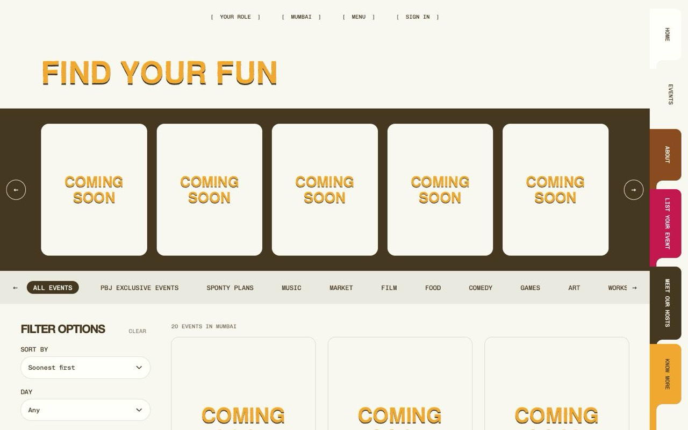 |

| List Your Event | Know More |
|---|---|
|  | 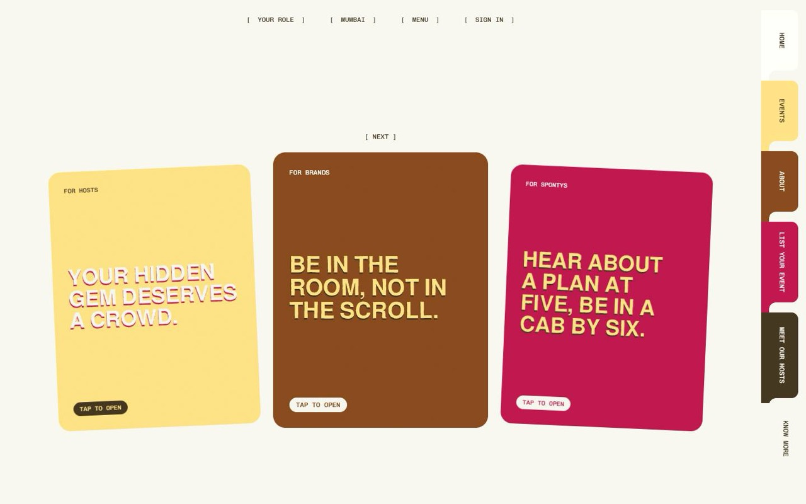 |

### Host dashboard and event page (computer)

| My events | Create an event |
|---|---|
| 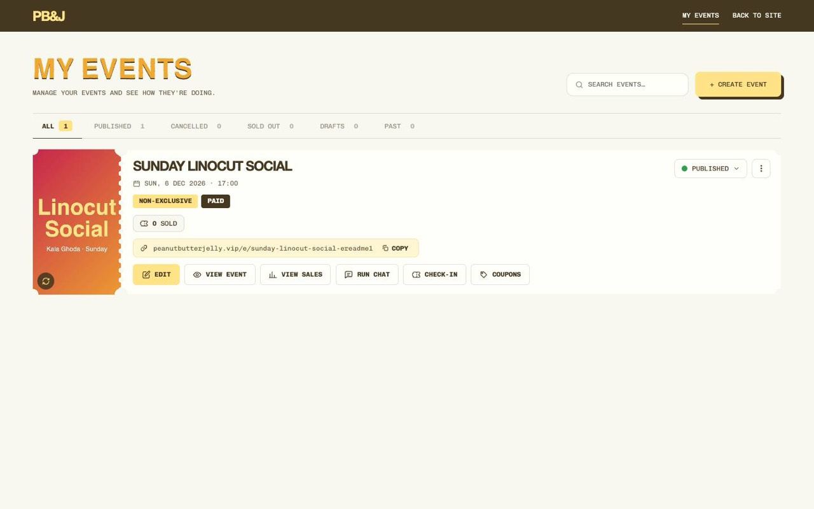 | 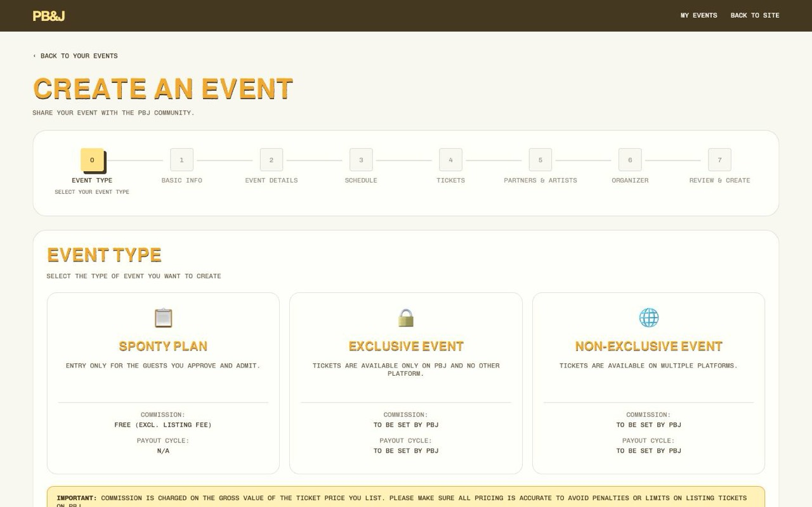 |

| Public event page |
|---|
| 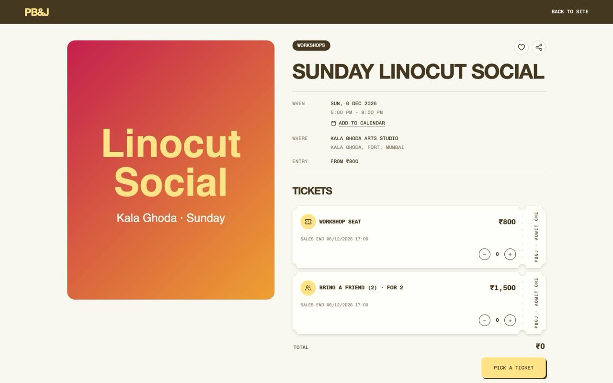 |

### On a phone

| Home | Spontys: For you | Spontys: Ask FUN |
|---|---|---|
| 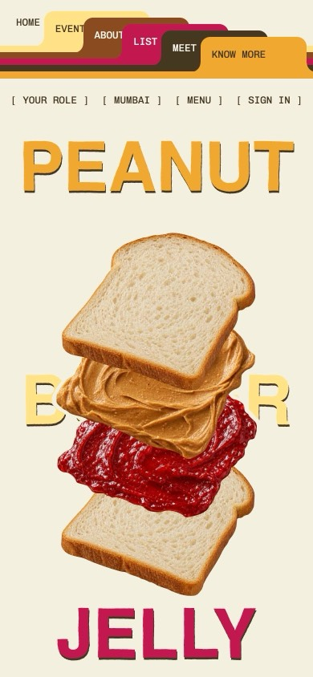 | 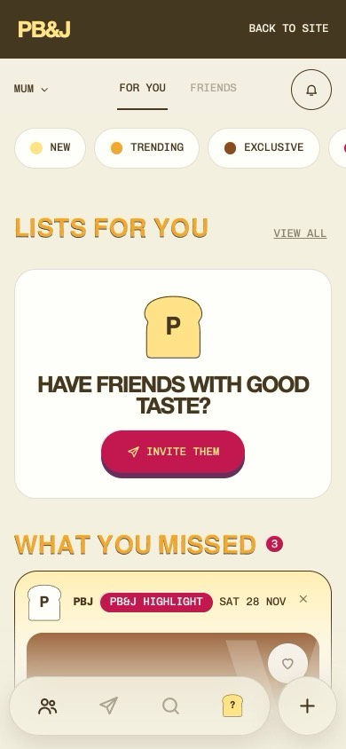 | 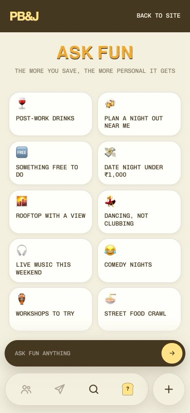 |

| Spontys: Messages | Spontys: Profile | Event page |
|---|---|---|
| 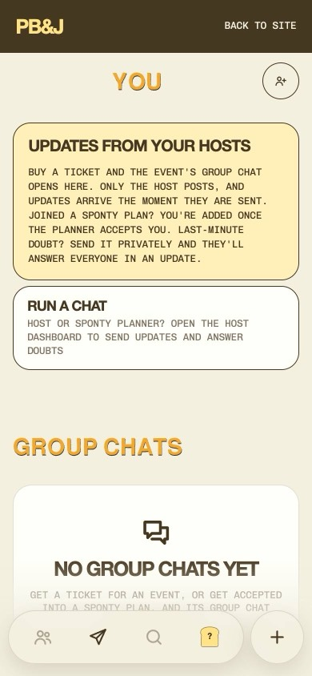 | 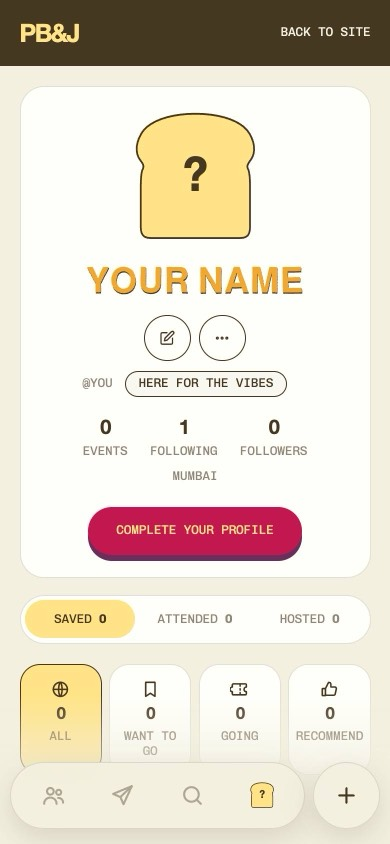 | 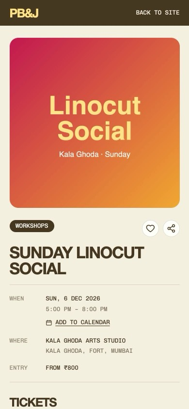 |

The event in these pictures ("Sunday Linocut Social") is a made-up sample.

## How it works today

- **Signing in:** an email link (no password), using Supabase. A **Continue with Google** button appears by itself once Google is switched on in Supabase. The first time a host signs in, a short welcome step asks who they are.
- **Profiles:** one profile per person (name, photo, handle, badge, city, about, links), the same on every device. People can delete their account themselves; everything linked to it is erased.
- **Events:** saved in the database. Anyone can see a published event; only its host can change it. Organizers' bank, PAN and contact details and coupon codes are kept in a separate, private part that only the host can read.
- **Photos:** uploaded to Supabase Storage (the `images` folder), each person into their own folder, after being shrunk in the browser.
- **Tickets and chats:** the server side (free tickets, guest lists, group chats) is built; parts of the Spontys app still run as a demo in the browser while they move over (see [`LAUNCH-MAP.md`](LAUNCH-MAP.md)).

## What it's built with

| Piece | Tools | Where it runs |
|---|---|---|
| Website and app | Vite, plain JavaScript, Three.js (3D mascot), GSAP and Lenis (motion and smooth scroll) | Vercel |
| Server | Python, FastAPI | Railway (Singapore, the closest region to Mumbai) |
| Database, sign-in and photos | Supabase (Postgres with row-level security, Auth, Storage) | Supabase |

## Folders

| Folder | What lives there |
|---|---|
| [`frontend/`](frontend/) | The website and app: pages (`index.html`, `spontys.html`, `dashboard.html`, `event.html`), `src/`, `public/`, helper `scripts/`, `film/` for videos, `lab/` for local experiments |
| [`backend/`](backend/) | The server. See [`backend/README.md`](backend/README.md) |
| [`supabase/`](supabase/) | Database changes (`migrations/`) and Supabase settings. See [`supabase/README.md`](supabase/README.md) |
| [`docs/screenshots/`](docs/screenshots/) | The pictures in this README |
| Top folder | Shared notes: [`PLAN.md`](PLAN.md) (what we're building, and what not yet), [`LAUNCH-MAP.md`](LAUNCH-MAP.md) (what exists and what's missing for launch), [`INSPIRATION.md`](INSPIRATION.md) and [`inspiration/`](inspiration/), plus [`AGENTS.md`](AGENTS.md) (git and PR rules) |

## Run it on your computer

### Website

```bash
cd frontend
npm install
npm run dev
```

Then open http://localhost:5173. Copy `frontend/.env.example` to `frontend/.env.local` and fill it in to connect sign-in and the database; without it the site still runs, and the dashboard keeps events in your browser.

### Server

```bash
cd backend
python3 -m venv .venv && source .venv/bin/activate
pip install -r requirements-dev.txt
uvicorn app.main:app --reload
```

Then open http://localhost:8000/api/health. Run the tests with `pytest`.

## How changes go live

Every change goes through a pull request, which is **squash-merged** into `main`. The PR title decides what deploys (full rules in [`AGENTS.md`](AGENTS.md)):

- `feat(frontend): …`, `fix(frontend): …`, `chore(frontend): …` put the **website** live on Vercel.
- `feat(backend): …`, `fix(backend): …`, `chore(backend): …` first apply any new **database changes** to Supabase, then put the **server** live on Railway once its tests pass.
- `docs(…)` and other scopes deploy nothing.

Website PRs include before/after screenshots at computer and phone sizes.
